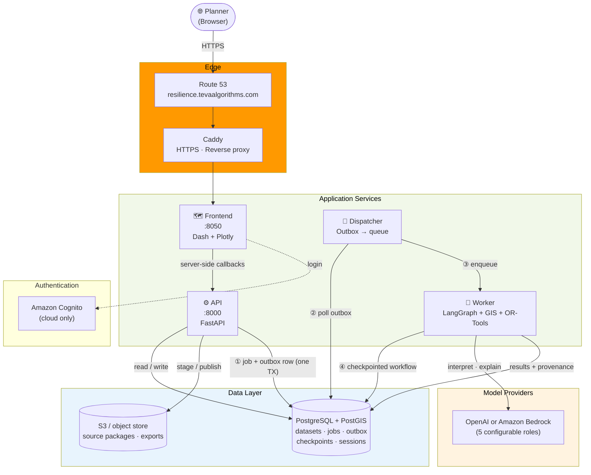

# Human Resilience Map — Extreme-Heat Planning Platform

> A planning application for exploring extreme-heat vulnerability and cooling-center access, built with Python, PostGIS, LangGraph and AWS.
> Designed to **teach grounded, verifiable AI workflows** through a real-world public-health planning domain.

This is a planning pilot. Scores are historical planning indices, not medical predictions.
Recommendations depend on reviewed facility inventories, candidate suitability, capacities,
costs and travel assumptions. Missing inputs stay visible rather than being invented.

**Live demo:** [resilience.tevaalgorithms.com](https://resilience.tevaalgorithms.com) (invite-only sign-in)

---

## What is this?

Human Resilience Map is a web application that helps public-health and emergency planners answer
three questions about extreme heat:

1. **Who is most vulnerable?** Every US census tract gets a transparent 0 to 100 resilience score
   built from land-surface heat, tree canopy, age, income and other indicators.
2. **What do we not know?** Missing data stays visible instead of being filled in with guesses.
3. **Where would new cooling centers help most?** Planners can test siting scenarios under
   capacity, budget and travel-time constraints, once a reviewed facility inventory is loaded.

It combines public datasets (Census ACS, Landsat surface temperature, NLCD tree canopy) with
deterministic GIS and optimization. LangGraph agents use a language model only to **interpret a
question and explain verified results**; they never calculate a number. Two areas are loaded today:
Travis County, TX and California statewide (9,129 census tracts).

## Why it matters

Extreme heat is a growing health risk, and it falls hardest on older adults, young children,
low-income communities and outdoor workers.

| Fact | Source |
| --- | --- |
| About 489,000 heat-related deaths occur each year worldwide (studies of 2000 to 2019) | [WHO, Climate change: heat and health](https://www.who.int/news-room/fact-sheets/detail/climate-change-heat-and-health) |
| Heat-related mortality among people over 65 rose by about 85% between 2000 to 2004 and 2017 to 2021 | [WHO](https://www.who.int/news-room/fact-sheets/detail/climate-change-heat-and-health) |
| In the US, heat-related deaths averaged 702 a year from 2004 to 2018 (415 as the underlying cause, 287 as a contributing cause) | [CDC MMWR, Heat-related deaths, 2004 to 2018](https://www.cdc.gov/mmwr/volumes/69/wr/mm6924a1.htm) |
| US deaths from excessive natural heat ranged from 297 (2004) to 1,153 (2020) | [CDC MMWR QuickStats, 1999 to 2020](https://www.cdc.gov/mmwr/volumes/71/wr/mm7134a5.htm) |
| Urban areas run about 1 to 7°F hotter by day and 2 to 5°F hotter at night than outlying areas | [US EPA, Learn about heat islands](https://www.epa.gov/heatislands/learn-about-heat-islands) |
| Older adults, young children, low-income populations and outdoor workers are the groups of greatest concern | [US EPA](https://www.epa.gov/heatislands/learn-about-heat-islands), [WHO](https://www.who.int/news-room/fact-sheets/detail/climate-change-heat-and-health) |

Heat risk is not spread evenly across a city: pavement, tree cover, age and income can all
change it from one census tract to the next. Cities have limited cooling resources, so
**where** they place them decides who is protected. Today that decision usually means stitching
together census tables, satellite imagery and facility lists by hand, and AI summaries of those
sources are hard to audit.

## How it helps

- **Target:** a tract-level map shows where heat, low canopy and vulnerable residents overlap, so
  limited resources go where they matter most.
- **Decide:** scenario comparison and sensitivity runs show how a siting choice changes who is
  covered, and what assumptions it depends on.
- **Trust:** every answer carries the dataset version, prompt version and verification result;
  claims are checked against tool output, and unsupported text is replaced.
- **Reuse:** new regions load as versioned source packages. Heat is the first hazard, and the
  same grounded-AI pattern is designed to extend to others, such as flood.

> **Scope:** this tool supports planning decisions; it does not predict individual health
> outcomes or prevent harm on its own. Its value depends on reviewed local inventories and on
> planners acting on the results.

---

## Architecture Overview



---

## Communication Patterns

| Interaction | Pattern | Transport | Why |
|---|---|---|---|
| Browser → Frontend | **Sync** | HTTPS (Caddy) | Interactive map and tract exploration |
| Frontend → API | **Sync REST** | HTTP | Server-side callbacks; the browser never touches the database |
| API → Analysis job | **Async via Outbox** | PostgreSQL | Job and outbox row commit atomically; long analyses never block a request |
| Dispatcher → Worker | **Async queue** | Local queue / SQS adapter | Decoupled execution, retryable |
| Worker → LLM | **Sync, bounded** | HTTPS | Only request interpretation and explanation use a model |
| Frontend → Job status | **Polling** | HTTP | Simple, resumable progress display |

---

## Data Flow: Analysis Request (Happy Path)

```
Step  Component           Action
----  ------------------  -----------------------------------------------------------
 1.   Planner             Selects study area, asks a question, sets constraints
 2.   Frontend            POST /v1/analyses  →  API
 3.   API                 Validates request, pins dataset/model versions
 4.   API                 Writes job (PENDING) + outbox event atomically in one DB TX
 5.   API                 Returns 202 Accepted { job_id }
 6.   Dispatcher          Polls outbox → queues the job
 7.   Worker              Interprets the request into a typed plan (LLM)
 8.   Worker              Checks data readiness for the requested operation
 9.   Worker              Computes risk, access, routing and facility selection (deterministic)
10.   Worker              Verifies geometry, bounds, capacity and solver status
11.   Worker              Runs comparison + bounded sensitivity variants
12.   Worker              Explains evidence (LLM), then checks claims against tool output
13.   Worker              Saves result, provenance and verification → job COMPLETE
14.   Frontend            Polls job → shows sites, coverage, assumptions, limitations ✅
```

## Data Flow: Missing or Infeasible Inputs

```
Step  Component           Action
----  ------------------  -----------------------------------------------------------
 1-7. (same as happy path through interpretation)
 8.   Worker              Readiness check finds missing candidates / capacity / roads
 9.   Worker              Returns an explicit incomplete result listing what is missing
10.   Data Quality Role   Explains the missing inputs and how to acquire them
11.   Frontend            Shows "incomplete" — nothing is invented to fill the gap
```

## Data Flow: Publish a Regional Dataset

```
Step  Component           Action
----  ------------------  -----------------------------------------------------------
 1.   Planner             Uploads cooling-centers CSV or complete region ZIP
 2.   API                 Stages the upload and validates every source file
 3.   Planner             Reviews validation report
 4.   API                 Publishes an immutable, versioned dataset
 5.   Planner             Downloads the published source package to edit or reuse
```

---

## Key Architectural Patterns

| Pattern | Where | What It Teaches |
|---|---|---|
| **LLM as interpreter, not calculator** | Worker | Models plan and explain; code computes scores, routes and optimal sites |
| **Outbox Pattern** | API → Dispatcher | Atomic job creation and dispatch without distributed transactions |
| **Checkpointed Workflow** | LangGraph on PostgreSQL | Resumable, inspectable multi-step jobs |
| **Programmatic Verification** | `verification/` | Independent checks on geometry, units, bounds, capacity and solver status |
| **Claim Grounding** | Explainer role | Unsupported generated text is replaced with a deterministic summary |
| **Immutable Dataset Versions** | Ingestion | Results stay reproducible against the dataset and scoring version they used |
| **Versioned Prompts** | `prompts/` | Prompt history retained for reproducibility |
| **Secrets from SSM** | Cloud runtime | No secrets in the repo; `.env` is local only |

---

## Components

| Component | Location | Responsibilities |
|---|---|---|
| **UI** | `src/resilience_map/frontend/` | Dash map, area questions, uploads, analysis results |
| **API** | `src/resilience_map/backend/` | Authenticated data, assistant, import and job endpoints |
| **Agent workflow** | `src/resilience_map/agents/` | Typed plans, bounded tools, LangGraph orchestration |
| **Analytical tools** | `risk/`, `gis/`, `optimization/`, `verification/` | Reproducible calculations and checks |
| **Data ingestion** | `src/resilience_map/ingestion/` | Acquisition, source validation, immutable publication |
| **Persistence** | `repository/`, `db/`, `workers/` | PostGIS, migrations, queue/outbox, checkpointed jobs |
| **Infrastructure** | `infrastructure/`, `deploy/` | Terraform and deployment utilities |

The graph order is
`interpret → validate → clarify/retrieve → readiness → analyze → verify → compare → sensitivity → explain → narrative check → finalize`.
Readiness, scoring, routing, optimization, comparison, sensitivity and verification are deterministic code.
See [architecture](docs/architecture.md) for details.

---

## LLM Roles

Five roles use the configured OpenAI or Bedrock model. Prompts are versioned in
[`src/resilience_map/prompts/`](src/resilience_map/prompts/), with `system.md` and `user.md` in each version.

| Role | Active prompt | Responsibility |
|---|---|---|
| Request interpreter | `interpret_request/v2` | Convert analysis questions into typed requests |
| Result explainer | `explain_results/v2` | Explain computed evidence and verified results |
| Area question planner | `area_question_planner/v1` | Route area questions to approved read-only tools |
| Data quality advisor | `data_quality_advisor/v1` | Explain missing inputs and acquisition steps |
| Scenario advisor | `scenario_advisor/v1` | Suggest planning experiments and explain readiness limits |

Answers carry model/prompt metadata and evidence. Numeric and identifier grounding checks can
replace unsupported generated text with a deterministic summary; they do not verify every prose claim.

---

## Tech Stack

| Layer | Technology |
|---|---|
| Language | Python 3.11–3.13 |
| Frontend | Dash + Plotly |
| API | FastAPI (Uvicorn / Gunicorn) |
| Database | PostgreSQL 16 + PostGIS 3.4 |
| ORM / Driver | SQLAlchemy 2.0 + psycopg 3 |
| Workflow | LangGraph (+ Postgres checkpointer) |
| Optimization | OR-Tools |
| Geospatial | Shapely, PyProj, Rasterio (`geo` extra) |
| Models | OpenAI or Amazon Bedrock (offline `stub` for tests) |
| Auth | Local dev identity · Amazon Cognito in the cloud |
| Infrastructure | Terraform · EC2 (Graviton) · Route 53 · S3 · ECR |
| Containers | Docker + Docker Compose |
| CI/CD | GitHub Actions (OIDC to AWS) |

---

## API Endpoints

| Endpoint | Purpose |
|---|---|
| `POST /v1/assistant/questions` | Ask about a pinned selected area |
| `POST /v1/analyses` | Submit an asynchronous analysis |
| `GET /v1/model`, `POST /v1/model/check` | Model configuration status and live connection check |
| `GET /v1/cooling-centers/template` | Download a blank cooling inventory CSV |
| `POST /v1/imports`, `POST /v1/imports/{id}/publish` | Stage/validate sources, then publish |
| `GET /v1/datasets/{version}/download` | Export a published source ZIP |
| `POST /v1/preparations` | Start bounded online regional preparation |

Full schemas at `http://localhost:8000/docs`. Local requests use the `X-Dev-User` header;
cloud requests require Cognito authentication.

---

## Project Structure

```
human-resilience-map/
├── README.md
├── docker-compose.yml
├── Dockerfile
├── Makefile
├── pyproject.toml / uv.lock
├── .env.example                 # Placeholders only — never commit real secrets
├── .env.production.example      # Non-secret production selectors
│
├── src/resilience_map/
│   ├── frontend/                # Dash map and UI
│   ├── backend/                 # FastAPI routes, auth, imports, exports
│   ├── agents/                  # LangGraph workflow, roles, tools
│   ├── prompts/                 # Versioned system/user prompts
│   ├── risk/                    # Scoring
│   ├── gis/                     # Access, routing, selection
│   ├── optimization/            # OR-Tools coverage + scenarios
│   ├── verification/            # Result checks and narrative grounding
│   ├── ingestion/               # Census, heat, canopy, roads, inventory
│   ├── repository/  db/         # Persistence + migrations
│   ├── workers/                 # Dispatcher, consumer, checkpointing
│   └── core/                    # Config, SSM, queue, object store, models
│
├── infrastructure/
│   ├── poc/                     # Low-cost Graviton POC (Terraform) → us-west-2
│   ├── terraform/               # ECS/RDS stack (reference)
│   └── ssm/                     # Parameter Store definitions
│
├── deploy/                      # POC and Lightsail runtime configuration
├── .github/workflows/           # CI + deploy-on-merge
├── scripts/                     # Data download and cleanup helpers
├── docs/                        # ADRs, architecture, deployment
└── tests/
    ├── unit/                    # Offline, provider-mocked tests
    └── integration/             # Tests against local PostGIS
```

---

## Quick Start

```bash
# 1. Clone and configure
git clone https://github.com/Tevaalgorithms/human-resilience-map.git
cd human-resilience-map
cp -n .env.example .env && chmod 600 .env

# 2. Generate secrets, then set HRM_DB_PASSWORD, HRM_SESSION_SECRET and OPENAI_API_KEY in .env
python3 -c "import secrets; print(secrets.token_urlsafe(48))"

# 3. Start the full stack (PostGIS + migrations + API + UI + dispatcher + worker)
make up            # or: docker compose --profile app up -d --build

# 4. Open the app and the API docs
open http://localhost:8050
open http://localhost:8000/docs
```

Use `HRM_LLM_PROVIDER=stub` to run offline rules/templates without real AI.
**Check model connection** in the UI makes a small live API call and consumes tokens.
A fresh checkout has no bundled production datasets and seeds no fictional records:
publish a regional dataset from the upload panel or the preparation workflow below.

If the database volume already exists, use its current password; changing `POSTGRES_PASSWORD`
in Compose does not rotate an existing PostgreSQL user's password.
Stop with `docker compose --profile app down` (named volumes keep data).

### Native development

```bash
make install       # uv sync --extra dev
make db-up         # local PostGIS
make migrate
make api           # :8000   (separate terminals)
make frontend      # :8050
make dispatcher
make worker        # dispatcher + worker are required for asynchronous analyses
```

---

## Regional Data and Uploads

Open **Upload region data or cooling centers** beside the map:

- **Cooling centers CSV** — select a study area, download the template, fill it from reviewed local
  evidence, validate and publish. This replaces the study area's entire inventory; blank capacity stays unknown.
- **Complete region source ZIP** — enter a region ID and name. Put `manifest.json`, `tracts.geojson`,
  `indicators.csv`, `centers.csv` and `candidates.csv` at the ZIP root (optional `roads.json`),
  review **Validate upload**, then **Publish validated dataset**.
- **Download selected dataset sources** — export the originally published sources as a ZIP.

Source data under `data/` and runtime files under `.data/` are local and ignored by Git.
Synthetic data exists only under `tests/fixtures` for offline automated tests.

**Online preparation:** set `HRM_CENSUS_API_KEY` and `HRM_ENABLE_PREPARATION=true` in `.env`, recreate
the API service, select map bounds and enter state/county FIPS. Online cooling inventory currently
supports LA County (`06/037`); other regions need local inventory uploads. An empty provider
response does not establish that no cooling centers exist.

**Off-host preparation:**

```bash
uv sync --extra dev --extra geo
uv run --extra geo hrm prep-census \
  --state 48 --counties 453 --year 2023 \
  --bbox='-97.85,30.20,-97.65,30.40' --out data/region-work
uv run --extra geo hrm prep-enrich --dir data/region-work --years 2021,2022,2023

uv run hrm validate-import --dir data/region-work
HRM_INGEST_DIR=data/region-work \
HRM_INGEST_STUDY_AREA_ID=your-region \
HRM_INGEST_STUDY_AREA_NAME='Your reviewed region' \
uv run hrm ingest --source files
```

---

## Deploying to AWS (Oregon, `us-west-2`)

The low-cost POC in `infrastructure/poc` creates a t4g.medium (30 GB encrypted disk), Elastic IP,
private S3 bucket, ECR repositories, Cognito login, Route 53 record for
**https://resilience.tevaalgorithms.com**, IAM roles and budget alerts. There is no NAT gateway, ALB,
RDS or ECS; PostgreSQL/PostGIS runs on the host. Terraform is pinned to AWS account `702018061088`
and refuses to run against any other account.

```bash
# One-time bootstrap (local credentials for the target account)
terraform -chdir=infrastructure/poc/bootstrap init
terraform -chdir=infrastructure/poc/bootstrap apply \
  -var='github_repository=Tevaalgorithms/human-resilience-map' \
  -var='hosted_zone_id=<ROUTE53_ZONE_ID>'
```

Then set the `POC_*` repository variables and merge to `main`; GitHub Actions validates, builds
native ARM images, applies Terraform and deploys over OIDC — no long-lived AWS keys.
See [deployment](docs/deployment.md) for the full runbook.

---

## Live AWS Deployment (Lightsail, `us-west-2`)

The currently running pilot is served at **https://resilience.tevaalgorithms.com** from a single
Lightsail host using Docker Compose ([lightsail](docs/lightsail.md)). It was created with the AWS
CLI, **not** the Terraform POC above, so none of the EC2, ECR, S3 or OIDC resources from that path
exist. Estimated cost is about **$24/month** plus optional OpenAI usage.

| Service | Resource | Purpose | Cost |
| --- | --- | --- | --- |
| Lightsail instance | `hrm-prod` (Ubuntu 24.04, `medium_3_0`: 2 vCPU, 4 GB RAM, 80 GB SSD) | Runs db, api, frontend, worker, dispatcher and Caddy via Compose | ~$24/mo |
| Lightsail static IP | `hrm-prod-ip` | Fixed public IPv4 attached to `hrm-prod` | Free while attached |
| Lightsail firewall | 80 and 443 open; 22 restricted to the admin IP | Public HTTPS and admin SSH | Free |
| Lightsail key pair | `hrm-key` | SSH access (private key stays on the operator machine) | Free |
| Route 53 | `A` record `resilience.tevaalgorithms.com`, alias `A` record `login.tevaalgorithms.com` and an ACM validation `CNAME`, in the existing `tevaalgorithms.com` zone | App host (static IP) and login host (Cognito CloudFront) | ~$0 |
| Cognito user pool | `hrm-prod`, app client `hrm-prod-web`, custom domain `login.tevaalgorithms.com`, branded sign-in page (`docs/branding/`) | Login (invite-only, optional MFA) | Free tier |
| ACM certificate (us-east-1) | `login.tevaalgorithms.com` | TLS for the Cognito custom domain (must be in us-east-1) | Free |
| SSM Parameter Store | `/human-resilience-map/prod/{database-password,session-secret,cognito-client-secret}` (SecureString) | Application secrets | Free |
| IAM | user `hrm-prod-host`, policy `hrm-prod-ssm-read` | Read-only access to those parameters; key kept in a mode-600 file on the host | Free |
| AWS Budgets | `hrm-monthly-30usd` | Email alert at 80% of $30/month (alerts only, not a cap) | Free |

HTTPS certificates are issued and renewed by Caddy (Let's Encrypt). Application data lives in
Docker volumes on the host disk. There is no ECS, RDS, NAT gateway or load balancer.

**Operating notes**

- Signed-out visitors to `/` see a public landing page with a Sign in button; `/login` goes straight to
  Cognito and every other path requires a session (`src/resilience_map/frontend/auth.py`).
- The LLM provider is `stub` until an OpenAI key is stored at
  `/human-resilience-map/prod/openai-api-key` and `HRM_LLM_PROVIDER=openai` is set in
  `deploy/lightsail/runtime.env` on the host.
- Host config (`runtime.env`, `.env`, `database.env`, `aws.env`) holds secrets or credentials and is not in Git.
- Add users with `aws cognito-idp admin-create-user`; self sign-up is disabled.
- Scheduled backups are not configured yet; see `deploy/lightsail/backup.sh` and the lightsail doc.

**Tear down** (stops all charges; the Cognito pool has deletion protection enabled)

```bash
aws lightsail release-static-ip --static-ip-name hrm-prod-ip --region us-west-2
aws lightsail delete-instance --instance-name hrm-prod --region us-west-2
aws lightsail delete-key-pair --key-pair-name hrm-key --region us-west-2
# delete the resilience.tevaalgorithms.com A record in Route 53
aws ssm delete-parameters --region us-west-2 --names \
  /human-resilience-map/prod/database-password \
  /human-resilience-map/prod/session-secret \
  /human-resilience-map/prod/cognito-client-secret
# then delete the hrm-prod-host IAM user (access key, attached policy), the policy, and the budget
```

---

## Checks and Cleanup

```bash
make lint        # Ruff, formatting and mypy
make test        # offline / provider-mocked unit tests
make test-all    # also integration tests against local PostGIS
make clean       # remove generated caches (preserves .env, .venv, data, Terraform state)
```

Integration tests recreate a dedicated test database; point `HRM_TEST_DATABASE_URL` only at a
disposable PostGIS database. Tests use stub/mocked providers and need no paid model calls or AWS access.

---

## Learning Goals

After working through this project you will understand:

- [x] Why an LLM should plan and explain while deterministic code computes
- [x] How to verify AI-assisted results programmatically and report incomplete inputs honestly
- [x] The Outbox Pattern — guaranteed job dispatch without distributed transactions
- [x] Checkpointed LangGraph workflows backed by PostgreSQL
- [x] Spatial analysis with PostGIS, routing and OR-Tools facility selection
- [x] Immutable, versioned datasets and reproducible results
- [x] Keeping secrets out of source control with SSM and GitHub OIDC
- [x] Deploying a small Python stack to AWS with Terraform and GitHub Actions

---

## Production Considerations

> These are documented for learning — not all are implemented in the POC.

1. **Inventory Review** — Reviewed facility inventories are required before operational use
2. **Model Evaluation** — Evaluate and select a Bedrock/OpenAI model before relying on outputs
3. **Security Review** — Independent review and load testing before real planner use
4. **Backup / Restore** — Rehearse database restore; POC backups are host-local scripts
5. **Managed Database** — RDS (see `infrastructure/terraform`) replaces host PostgreSQL at scale
6. **Edge Protection** — Add WAF, autoscaling and multi-AZ when traffic warrants
7. **Secrets Management** — SSM SecureString / Secrets Manager replace `.env` in the cloud
8. **Observability** — CloudWatch logs and alarms linking API and worker events by job ID

Architecture decisions: [ADR-001](docs/ADR-001.md) · [ADR-002](docs/ADR-002-terraform.md)

---

*Built by [Tevaganthan Veluppillai](https://github.com/Tevaalgorithms) · [Medium](https://medium.com/@teva15) · [LinkedIn](https://www.linkedin.com/in/tevaganthan)*
