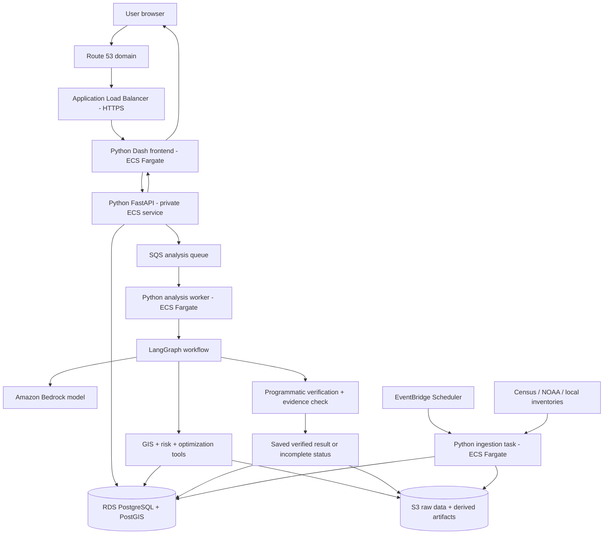
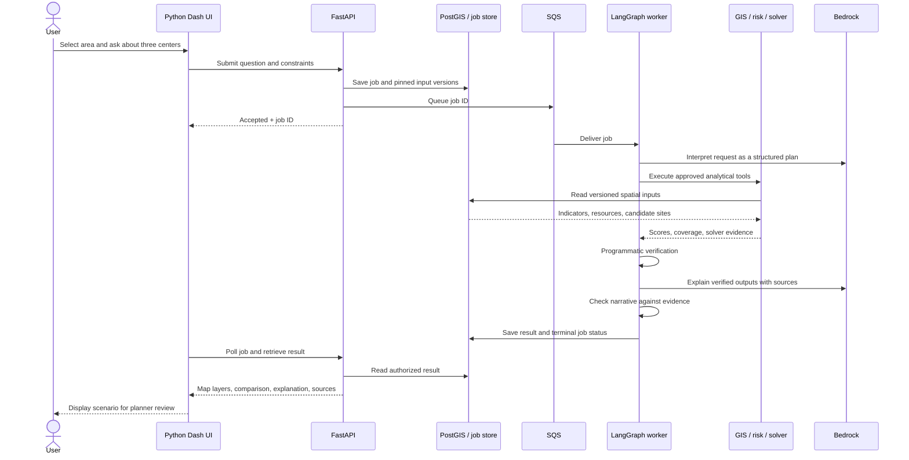

# Human Resilience Map — Python and AWS Architecture

Design proposal, October 4, 2026. This document defines the intended implementation; no infrastructure has been deployed.

## Implementation choice

Use **Dash + Plotly for the Python-authored frontend**, **FastAPI for the Python API**, and **Python workers for GIS, LangGraph, and optimization**. Dash supplies the browser UI through its JavaScript components; application layouts and callbacks are written in Python. This supersedes the earlier React frontend proposal for V1. SQL and deployment configuration are still needed alongside Python.

The frontend offers a map, indicator cards, a question panel, scenario controls, progress, and a comparison table. It calls the API through server-side callbacks; database access and analytical calculations stay behind the API. Bound tract GeoJSON responses by study area and zoom/detail to keep the pilot map responsive. Add vector tiles only if measured size or performance requires them.

## AWS deployment flow



The private API is reached through ECS service discovery, with security groups allowing frontend-to-API traffic. Only the HTTPS load balancer is publicly exposed. ECS tasks and RDS run in private subnets; outbound access to public data sources uses controlled egress. AWS service access uses VPC endpoints where appropriate. The private network and endpoints have ongoing costs and should be sized for the pilot.

| Responsibility | AWS service / application |
| --- | --- |
| Domain and HTTPS | Route 53, ACM certificate, Application Load Balancer |
| UI, API, analytical workers | Separate ECS Fargate services using Docker images |
| Spatial database and scenario metadata | RDS PostgreSQL with a compatible PostGIS extension |
| Raw snapshots, processed rasters, exports | Private S3 buckets with versioning and lifecycle policies |
| Analysis queue and failures | SQS queue and dead-letter queue |
| Scheduled ingestion | EventBridge Scheduler starts an ECS ingestion task |
| LLM inference | Bedrock; select a supported model and region after access, quality, and cost checks |
| Authentication | Cognito login with an authorization-code flow; Dash keeps tokens server-side, API validates user identity and access |
| Secrets and permissions | Secrets Manager and per-service IAM task roles |
| Logs and metrics | CloudWatch, with job IDs linking API and worker events |
| Image publishing and deployment | ECR; proposed GitHub Actions and Python AWS CDK infrastructure |

Use secure server-side sessions with a shared session store if the Dash frontend runs multiple replicas. This can use a separate PostgreSQL schema for V1. Avoid dependence on container-local memory for sessions, job state, or results.

## End-to-end user flow

Example: **“Which communities are most vulnerable to extreme heat, and where should we open three cooling centers?”**

1. **Open the application.** The user signs in and selects the pilot metro area. Dash requests the latest published dataset version, tract scores, and existing cooling centers through FastAPI.
2. **Explore the baseline.** The map displays precomputed tract indicators and resilience scores. Clicking a tract loads its evidence, source dates, uncertainty, and access gaps without invoking an LLM.
3. **Submit a scenario.** The user supplies the question and constraints: number of centers, feasible candidate sites, travel mode and threshold, capacity, and budget. Missing essential constraints prompt clarification.
4. **Create an analysis job.** FastAPI validates the request and authorization, pins dataset/model versions, stores a job record, queues its identifier, and returns an accepted response with a job ID. Dash polls for progress, so long analysis does not occupy a browser request.
5. **Plan with LangGraph.** The orchestrator produces a structured plan, checks operation-specific data readiness, and can coordinate bounded comparison and sensitivity runs. These roles are deterministic nodes, not additional LLM calls.
6. **Calculate deterministically.** PostGIS and Python tools identify vulnerable underserved tracts, compute route-based access where data supports it, and run constrained facility selection using OR-Tools. The LLM does not compute population totals, scores, routes, or optimal sites.
7. **Verify the result.** Checks cover data completeness, geometry and units, score bounds, population double-counting, candidate feasibility, capacity constraints, solver status, and sensitivity. Unsupported or infeasible requests return an explicit incomplete/infeasible result.
8. **Explain checked evidence.** The LLM receives structured tool outputs and source references. A claim check compares its explanation with those outputs. Failed narrative checks can fall back to a deterministic results summary.
9. **Publish the scenario result.** The worker saves the result, provenance, and exports, then marks the job complete. Dash retrieves the verified payload and shows recommended sites, baseline-versus-scenario coverage, affected tracts, assumptions, and limitations.
10. **Review and export.** A planner compares alternatives and downloads a report or GeoJSON. Local review confirms operational suitability before resource allocation; an analysis result does not itself open a cooling center.

The implemented graph order is `interpret → validate → clarify/retrieve → readiness → analyze →
verify → compare → sensitivity → explain → narrative check → finalize`. Interpretation and
explanation use the configured LLM. Readiness rules, all calculations, each alternative and variant,
and independent verification use approved typed tools. See [agent roles](agent_roles.md) for request
and result contracts and total-job limits.



## Data pipeline flow

**Source → immutable S3 snapshot → validation and transformation → versioned PostGIS tables / S3 rasters → precomputed indicators and coverage → publish dataset version → UI and analysis jobs.**

Ingestion records source URLs, licenses, acquisition dates, observation periods, geographic coverage, and checksums. Normalize tract identifiers and coordinate systems, retain ACS margins of error, and distinguish surface temperature from air temperature. Validate candidate-site inventories and record last confirmation dates.

Publish only a complete validated dataset version. Failed refreshes preserve the last usable release and display its age. Every scenario pins a published version so a later refresh does not silently alter its results.

## Backend boundaries and proposed API

| Component | Owns |
| --- | --- |
| API | Authentication, authorization, input validation, bounded map queries, job creation and result delivery |
| GIS module | Spatial joins, raster summaries, tract indicators, travel/service-area calculations |
| Risk module | Documented normalization, weights, missing-data handling, score contributions |
| Optimization module | Feasible-site selection, non-duplicated coverage, capacity and budget constraints, solver evidence |
| Agent workflow | Request interpretation, operation-specific readiness, sequential comparison and sensitivity coordination, clarification, checkpointed state, grounded explanations |
| Verification module | Analytical checks, evidence consistency, incomplete-result handling |
| Ingestion module | Source snapshots, transformations, validation, dataset publication |

Proposed routes:

- `GET /v1/study-areas` and `GET /v1/datasets`: available areas and published data versions.
- `GET /v1/tracts?study_area_id=...&dataset_version=...`: bounded map features and indicators.
- `GET /v1/tracts/{tract_id}`: factor contributions, source dates, and access detail.
- `POST /v1/analyses`: create an asynchronous question/scenario job; return HTTP 202 and job ID.
- `GET /v1/analyses/{job_id}`: status, progress, clarification request, or authorized result.
- `POST /v1/analyses/{job_id}/clarifications`: supply required inputs and resume the workflow.
- `GET /v1/analyses/{job_id}/exports`: authorized downloads or short-lived signed S3 links.

Job states: `queued → running → needs_input / completed / incomplete / failed`. Resume a `needs_input` job using the same recorded workflow context, including comparison and uncertainty requests. Result payloads include readiness reasons/evidence, dataset and scoring versions, scenario constraints, tool/solver status, per-run verification, baseline/scenario coverage, bounded sensitivity summaries, checked explanation, sources, and limitations.

Persist LangGraph checkpoints in PostgreSQL using separate tables/schema. SQS can deliver a message more than once: use job idempotency, atomic worker claims, retry-safe writes, visibility extensions for long jobs, and a dead-letter queue. Persist job creation and an outbox entry in one transaction; a dispatcher reliably sends outbox entries to SQS to avoid losing jobs between database and queue writes. A duplicate delivery must not trigger duplicate completed analyses.

## Proposed Python code organization

```text
human-resilience-map/
  frontend/           # Dash pages, map components, API client, callbacks
  backend/            # FastAPI routes, schemas, authentication
  agents/             # LangGraph state, nodes, tool bindings, checkpoints
  gis/                # Spatial and raster analysis
  risk/               # Scoring and sensitivity
  optimization/       # Coverage models and facility selection
  verification/       # Data, calculation, and narrative checks
  ingestion/          # Source adapters and dataset publication
  workers/            # Queue consumer and outbox dispatcher
  infrastructure/     # Python AWS CDK deployment definitions
  tests/              # Analytical fixtures and end-to-end scenarios
  docs/               # Architecture, data dictionary, assumptions
```

This is a proposed future implementation layout, not a claim that these modules already exist.

## Deployment and validation

Develop locally with the UI, API, worker, and PostgreSQL/PostGIS containers. Validate scoring against known fixtures, geometry/unit handling, duplicate coverage, infeasible optimization, duplicate queue delivery, job ownership, and narrative grounding. Include one full scenario from submission through displayed results.

Build container images, publish them to ECR, and deploy a staging environment using Python CDK. Apply database migrations, ingest the pilot data, verify the published baseline, and run the complete scenario before production rollout. Production sizing, backups, recovery objectives, and availability requirements remain pilot decisions. Limit solver runtime, model usage, request size, and concurrent jobs; monitor errors, queue age, data freshness, and costs.

## Official references

- [Dash documentation](https://dash.plotly.com/) and [Dash source](https://github.com/plotly/dash): Python-authored interactive frontend with browser components.
- [ECS service load balancing](https://docs.aws.amazon.com/AmazonECS/latest/developerguide/service-load-balancing.html): Fargate service and load-balancer integration.
- [RDS PostgreSQL extensions](https://docs.aws.amazon.com/AmazonRDS/latest/UserGuide/Appendix.PostgreSQL.CommonDBATasks.Extensions.html): PostGIS support; choose compatible engine/extension versions.
- [Bedrock model availability](https://docs.aws.amazon.com/en_en/bedrock/latest/userguide/models.html): model, API, and regional availability checks.
- [LangGraph checkpoint types](https://reference.langchain.com/python/langgraph/types/Checkpointer): workflow persistence interfaces.

## Heat planning and separate monitoring (2026-10)

The immutable dataset bundle now includes inventory metadata/readiness and an optional bounded
road snapshot. Ingestion schema v2 creates a new content-derived version when existing snapshots
are reimported. Migration 0002 adds JSONB center metadata, nullable unknown capacity, road JSONB
and explicit inventory status. APIs and exports preserve these fields.

Analysis can use the existing proxy or directed mode-specific Dijkstra; a requested network model
requires its pinned snapshot. Optimization and independent verification recompute access, with
explicit unmatched/unreachable pairs and boundary coverage checks. Selection crops centroid
population only; roads/destinations remain surrounding. Historical score semantics stay versioned.

NWS monitoring lives in a separate API module/cache and never enters the analysis score. Feed
sections have independent availability and clocks. Owner-restricted asynchronous Census preparation
creates unpublished files on persistent storage, bounded by process/time/storage limits; it is
disabled on the 4 GB host. Large raster/OSM preparation runs off-host. The optional OSMnx preparer
normalizes mode-filtered MultiDiGraphs for the lightweight runtime. See routing/monitoring docs.

Initial hosting is now the Lightsail Compose path in `deploy/lightsail`; the separate EC2 POC and
ECS/RDS paths remain intact. See `lightsail.md` for their operational differences.
